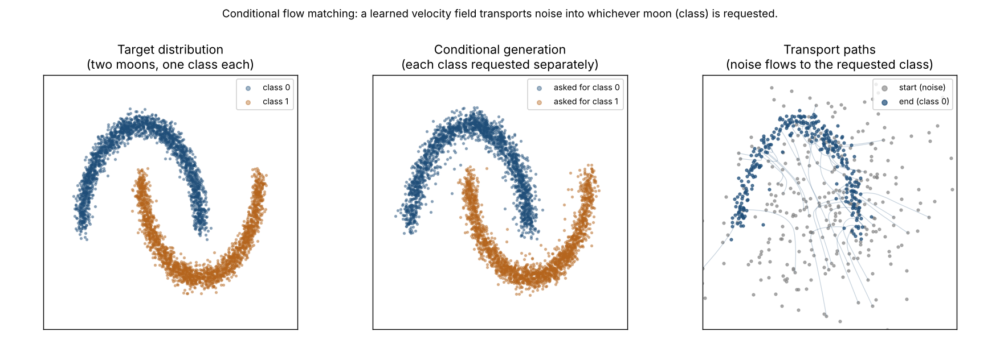

# Conditional flow matching from scratch (2-D)

[](https://github.com/hager-safwat/conditional-flow-matching/actions/workflows/tests.yml)

[](LICENSE)

A minimal, tested implementation of **flow matching** (Lipman et al., 2023),
trained with the conditional flow-matching objective and **label
conditioning**, so you can steer *which* part of the distribution is
generated.

The target is a two-moons distribution where each moon is a class
(0 = upper, 1 = lower). After training, asking for class 0 generates the upper
moon and class 1 the lower one: a *controllable* generator.



## How it differs from diffusion

A diffusion model learns to **denoise** in many small stochastic steps. Flow
matching instead learns a **velocity field** that transports a simple base
distribution (a Gaussian) into the data, and generates by integrating an
ordinary differential equation.

## The two ideas

**Straight-line conditional paths.** Pick a noise point `x0 ~ N(0, I)` and a
real point `x1`, and interpolate:

```
x_t = (1 - t) * x0 + t * x1,      t in [0, 1]
```

Along that path the velocity is constant: `dx_t/dt = x1 - x0`.

**Regress the velocity.** Train `v_theta(x_t, t, c)`, also given the class
label `c`, to predict `x1 - x0` with an MSE loss. To generate class `c`,
start from noise and integrate `dx/dt = v_theta(x, t, c)` from `t = 0` to
`t = 1` (here with 100 explicit Euler steps).

The training loss does not go to zero, and that is expected: many `(x0, x1)`
pairs pass through the same `x_t`, so the best possible prediction is their
average velocity and the remaining variance cannot be removed.

## Setup and results

| | |
|---|---|
| Data | 4000 points, two moons (2000 per class), jitter 0.06, standardised |
| Network | MLP, 3 hidden layers of 256, SiLU; 64-dim time embedding, 32-dim learned class embedding (157,506 parameters) |
| Training | Adam, lr 1e-3, batch 512, 8,000 steps |
| Sampling | 2000 points per class, 100 Euler steps |

Conditioning check, seed 0 (mean nearest-neighbour distance, standardised
units; the floor between two independent draws of real data is 0.016):

| Requested | to the correct moon | to the other moon | samples nearest the correct class |
|---|---|---|---|
| class 0 | 0.021 | 0.811 | 99.9 % |
| class 1 | 0.018 | 0.792 | 100.0 % |

Samples land almost at the real-data floor for the requested class and far
from the other one, so the label really controls which mode is generated.

## Run it

```bash
git clone https://github.com/hager-safwat/conditional-flow-matching.git
cd conditional-flow-matching
pip install -e ".[demo]"
python cfm_demo.py
```

The full run takes a few minutes on a laptop CPU (measured: about 6 minutes
on a 2-core cloud machine). It prints the loss and the conditioning check and
regenerates `figure.png`. Quick check: `python cfm_demo.py --steps 300 --no-figure`.

## Tests

```bash
pip install -e ".[dev]"
pytest -v
```

| Test | What it verifies |
|---|---|
| `test_path_velocity_is_constant_and_equals_target` | finite differences of the path equal `x1 - x0` at several `t` |
| `test_sampler_reaches_target_with_oracle_velocity` | with the exact velocity `(target - x) / (1 - t)`, the Euler sampler lands on the target, testing sampling independently of training |
| `test_class_label_changes_the_prediction` | the class embedding actually changes the output |
| plus data, embedding, training, metric and smoke tests | |

Every push and pull request runs `ruff` and the tests on Python 3.10 and 3.12.

## Repository structure

```
cfm/
    data.py      labelled two-moons data
    model.py     time embedding and velocity network
    flow.py      probability path, training loop, ODE sampler, metric
cfm_demo.py      experiment, conditioning check and figure
tests/           pytest suite
```

## Scope

This is a **mechanism demo on synthetic data**: the smallest complete
conditional flow-matching setup that still shows every moving part. It is not
a benchmark. The technique comes from my master's coursework, where I applied
conditional flow matching to an image-based problem; this repository
reimplements the core method from scratch on toy data, with no project data
involved.

## Reference

- Y. Lipman, R. Chen, H. Ben-Hamu, M. Nickel, M. Le, *Flow Matching for
  Generative Modeling*, ICLR 2023.

## License

MIT, see [LICENSE](LICENSE).
